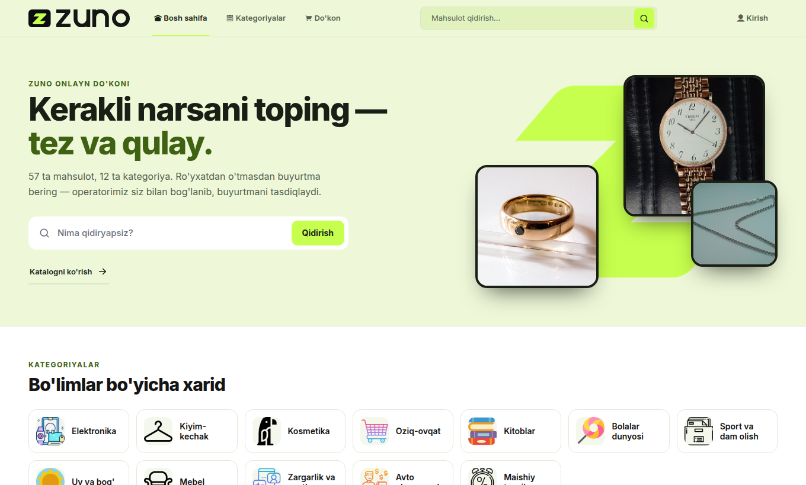
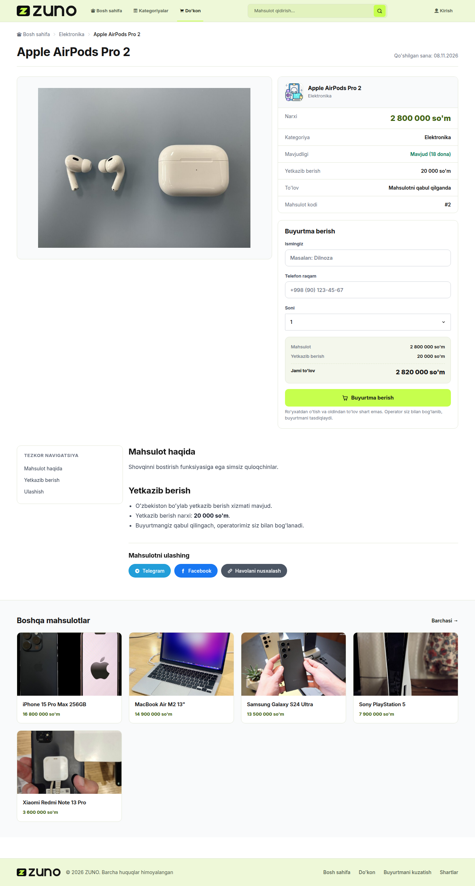
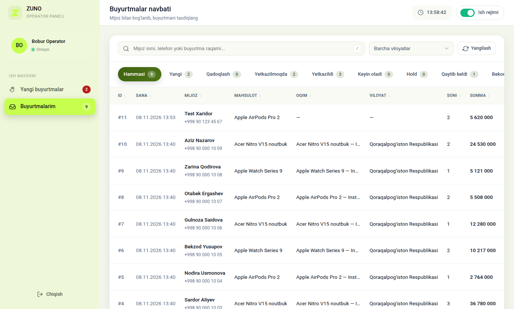
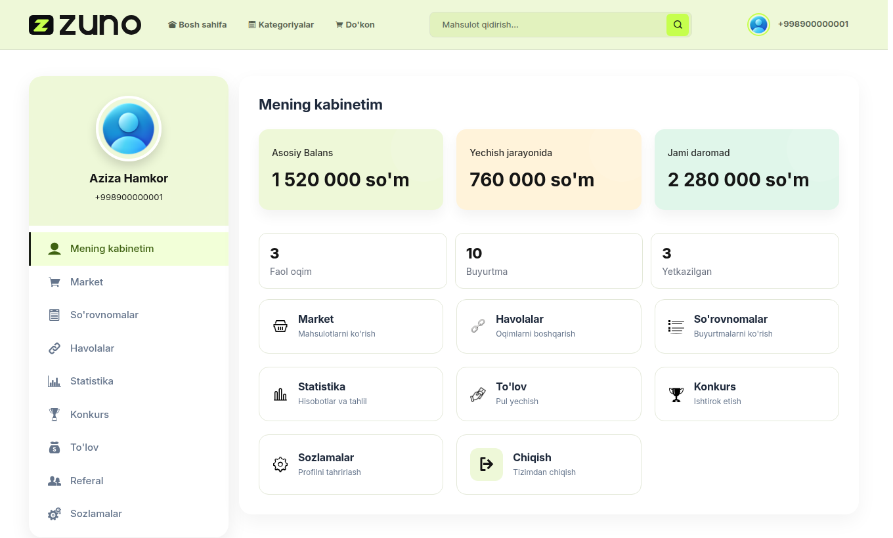
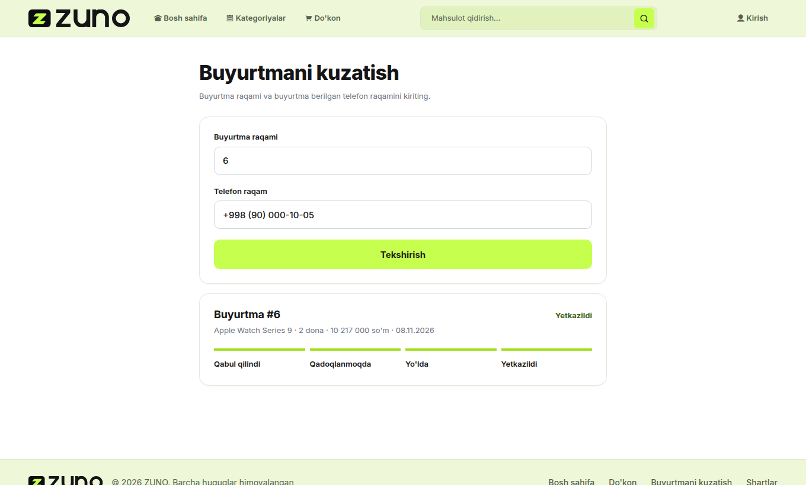

<p align="center"></p>

<p align="center">
  <a href="https://github.com/abuzafar-dev/zuno/actions/workflows/ci.yml"></a>
  
  
  
</p>

# ZUNO

O'zbekiston uchun hamkorlik (affiliate) marketingiga asoslangan onlayn do'kon. Mijoz ro'yxatdan
o'tmasdan buyurtma beradi va mahsulotni olganda to'laydi. Operator buyurtmani qo'ng'iroq orqali
tasdiqlaydi. Hamkor esa o'z havolasi orqali sotilib, **yetkazilgan** har bir buyurtmadan komissiya oladi.

*An affiliate-driven, cash-on-delivery storefront for Uzbekistan: customer storefront, seller cabinet
and call-centre panel on Django 6 and PostgreSQL.*

**[Taqdimot sahifasi](https://abuzafar-dev.github.io/zuno/)** · [Arxitektura](docs/ARCHITECTURE.md) · [Tadqiqot](docs/RESEARCH.md) · [Brend](docs/BRAND.md)



## Imkoniyatlar

| Kim uchun | Nima bor |
|---|---|
| **Mijoz** | Katalog, qidiruv, saralash. Hisobsiz buyurtma, oldindan ko'rinadigan yakuniy narx, qabul qilganda to'lov, raqam va telefon bilan buyurtmani kuzatish |
| **Hamkor** | Har bir mahsulot uchun shaxsiy sotuv havolasi, o'z komissiyasidan chegirma berish, statistika, balans va daromad tarixi, pul yechish, referal, konkurs |
| **Operator** | Buyurtmalar navbati, buyurtmani o'ziga olish, status bo'yicha yuritish, mijoz tarixi, klaviatura yorliqlari |
| **Admin** | Django admin orqali mahsulot, komissiya, buyurtma, pul yechish so'rovlari |

<table>
  <tr>
    <td width="50%"><br><sub>Yakuniy narx buyurtmadan oldin ko'rinadi</sub></td>
    <td width="50%"><br><sub>Operator navbati</sub></td>
  </tr>
  <tr>
    <td><br><sub>Hamkor kabineti: haqiqiy daromad ko'rsatkichlari</sub></td>
    <td><br><sub>Buyurtmani hisobsiz kuzatish</sub></td>
  </tr>
</table>

## Muhandislik yechimlari

- **Pul jurnali.** Har bir balans o'zgarishi `BalanceTransaction` jurnaliga yoziladi. `(order, kind)` unique cheklovi bitta buyurtmaga komissiya ikki marta tushishiga yo'l qo'ymaydi.
- **Ombor poygasi yo'q.** Buyurtma tranzaksiya ichida qator qulfi (`SELECT ... FOR UPDATE`) bilan tovarni band qiladi. So'nggi dona faqat bir marta sotiladi, bu parallel test bilan tekshirilgan.
- **Status mashinasi.** Buyurtma faqat ruxsat etilgan yo'ldan yuradi. Ombor qaytishi va komissiya shu o'tishlarga bog'langan, admin ham shu servisdan o'tadi.
- **Narx nusxasi.** Birlik narxi, yetkazish va komissiya buyurtma paytida saqlanadi, keyingi narx o'zgarishi eski buyurtmaga ta'sir qilmaydi.
- **Himoya.** Kirish, ro'yxatdan o'tish, buyurtma va kuzatish uchun so'rov limitlari, xavfsiz `next` yo'naltirish, HTTPS sozlamalari, CSRF.

To'liq sxema: [docs/ARCHITECTURE.md](docs/ARCHITECTURE.md).

## Ishga tushirish

Kerak: Docker va [uv](https://github.com/astral-sh/uv).

```bash
git clone https://github.com/abuzafar-dev/zuno.git
cd zuno
make setup            # .env yaratadi: SECRET_KEY va DB_PASSWORD ni o'zgartiring
make db               # PostgreSQL 18 va Redis
make demo             # jadvallar, viloyatlar, mahsulotlar, namuna hamkor va operator
make run              # http://127.0.0.1:8000
```

Namuna kirish ma'lumotlari (`make demo`, faqat `DEBUG=True` da yaratiladi):

| Rol | Telefon | Parol |
|---|---|---|
| Hamkor | `+998 90 000 00 01` | `Zuno-Demo-2026` |
| Operator | `+998 90 000 00 02` | `Zuno-Demo-2026` |

Butun ilovani konteynerda: `docker compose --profile app up -d --build`.

Testlar PostgreSQL'da ishlaydi: `make test`.

## Texnologiyalar

Django 6 · Python 3.14 · PostgreSQL 18 · Redis · Gunicorn · WhiteNoise · Bootstrap 4 · Docker · GitHub Actions

Tashqi CDN ishlatilmaydi: shrift, ikonka va skriptlar loyiha ichida.

## Muhit o'zgaruvchilari

| O'zgaruvchi | Tavsif |
|---|---|
| `SECRET_KEY`, `DEBUG`, `ALLOWED_HOSTS` | Django asosiy sozlamalari |
| `DB_NAME`, `DB_USER`, `DB_PASSWORD`, `DB_HOST`, `DB_PORT` | PostgreSQL |
| `REDIS_URL` | Bir nechta worker uchun umumiy so'rov limitlari |
| `CSRF_TRUSTED_ORIGINS`, `HTTPS_ONLY`, `TRUST_X_FORWARDED_FOR` | Reverse-proxy ortida ishlash |
| `SERVE_MEDIA`, `LOG_TO_FILE` | Media fayllar va `logs/zuno.log` |

## Muallif

[Abuzafar Eshboboyev](https://github.com/abuzafar-dev). Namuna rasmlar mualliflari: [docs/IMAGE_CREDITS.md](docs/IMAGE_CREDITS.md).
