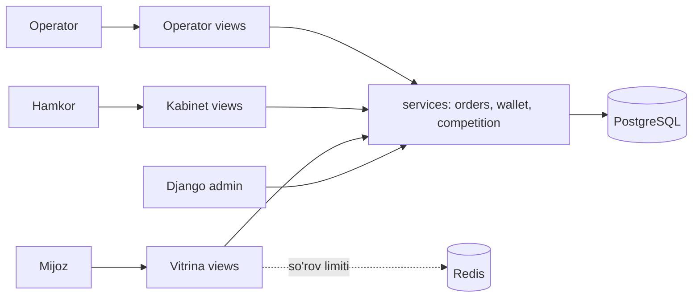
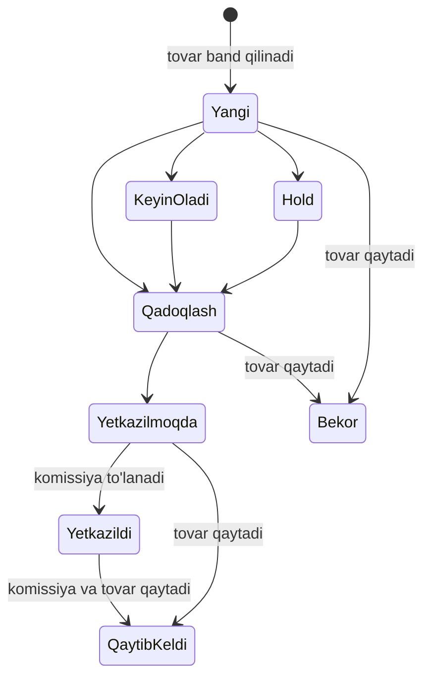

# Arxitektura

Loyiha bitta Django ilovasi: qatlamlar aniq ajratilgan, biznes qoidalari esa bir joyda.

| Qatlam | Joyi | Vazifasi |
|---|---|---|
| HTTP | `apps/views/{storefront,accounts,cabinet,operator}.py` | So'rovni o'qish va javob berish |
| Biznes qoidalari | `apps/services/{orders,wallet,competition}.py` | Ombor, status, komissiya, pul yechish |
| Ma'lumot | `apps/models.py`, `apps/migrations/` | Sxema, cheklovlar, indekslar |
| Yordamchi | `apps/utils.py` | Telefon, slug, kirish qiymatlarini tozalash, limit |
| Interfeys | `templates/`, `apps/apps/brand/` | Shablonlar va yagona brend tokenlari |

## Buyurtma holatlari

Barcha o'tishlar `apps/services/orders.py` dagi `ALLOWED_TRANSITIONS` jadvalida. Arxiv holati yakunlangan buyurtmalar uchun.

## Pul va bir vaqtdagi so'rovlar

- `place_order` mahsulot qatorini `select_for_update` bilan qulflaydi: ikki mijoz oxirgi donani bir vaqtda ololmaydi.
- `change_status` buyurtma qatorini qulflaydi, shuning uchun ikki marta bosish komissiyani ikki marta yozmaydi.
- `BalanceTransaction` da `(order, kind)` unique: himoyaning ikkinchi qatlami baza darajasida.
- `pending_balance` manfiy bo'lishi `CHECK` cheklovi bilan taqiqlangan.
- Chegirma hamkor komissiyasidan beriladi: `0 <= chegirma <= komissiya`.
- Hamkor o'z havolasi orqali o'zi xarid qilsa, komissiya hisoblanmaydi.
- `apps/tests.py` dagi `ConcurrencyTests` bularni haqiqiy parallel ulanishlar bilan tekshiradi.

## Ishlab chiqarish

`Dockerfile` ilovani root bo'lmagan foydalanuvchi bilan gunicorn orqali ishga tushiradi. Statik fayllarni WhiteNoise beradi. `/healthz/` baza ulanishini tekshiradi. Sozlamalar faqat muhit o'zgaruvchilaridan olinadi va `DEBUG=False` holatida standart maxfiy kalit bilan ilova ishga tushmaydi.
